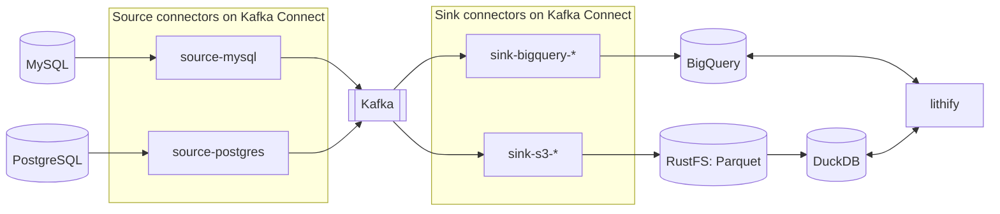

# lithify

lithify turns the change log a database leaves behind into tables a warehouse can query: a snapshot of every table at the end of a window (and, on the [roadmap](doc/roadmap.md), a history of every row), carried through the schema changes the source went through.
Everything is built inside the warehouse from the raw change log, which is kept as it was captured, so any table can be rebuilt from it at any time.

The application lives in `lithify/`. A local CDC stack to run it against lives in `compose/`, see [compose/README.md](compose/README.md). `scripts/` installs the clients that stack is reached with on the developer's machine.

