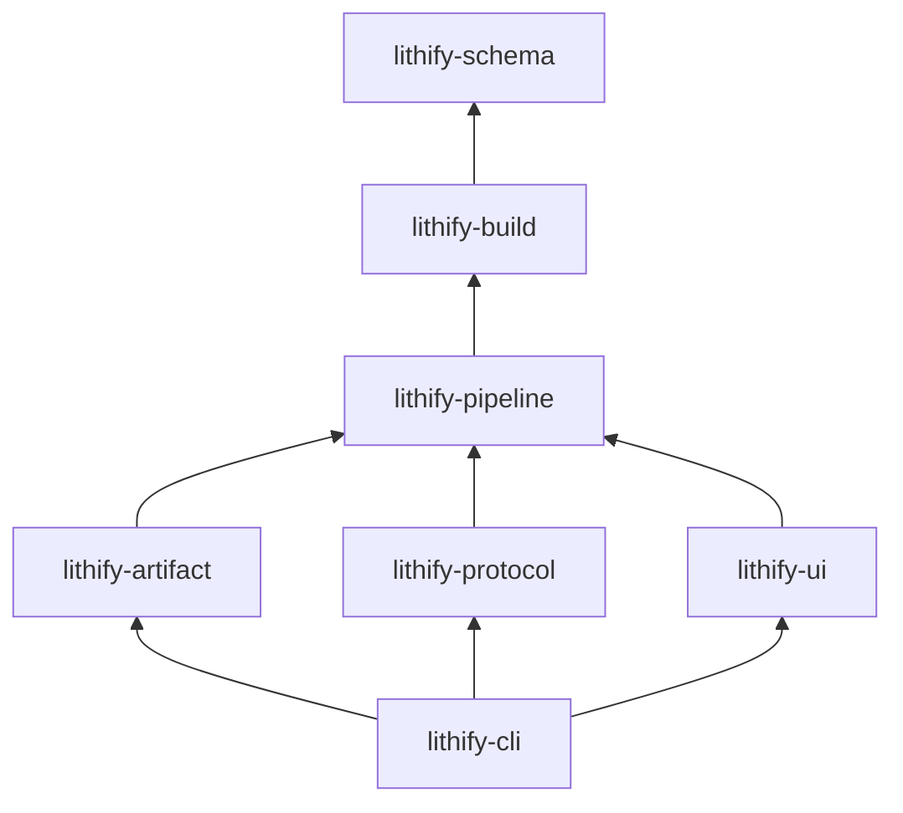
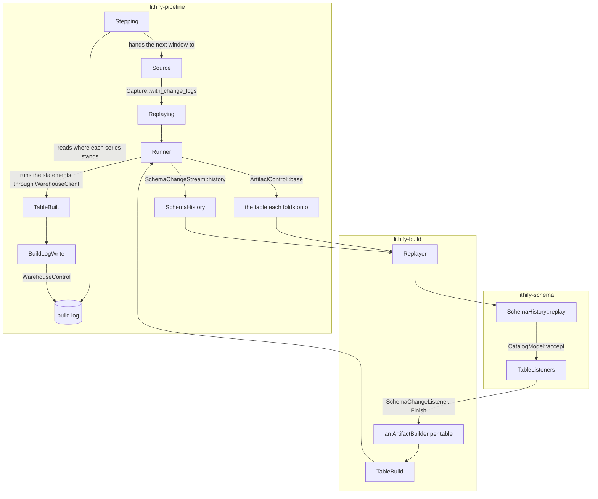

# Architecture

How the code is laid out and the rules it keeps, as opposed to the [design](design.md), which settles what lithify does, and the [roadmap](roadmap.md), which tracks what is still to be done.

## Code map

| Crate | Holds |
| --- | --- |
| `lithify-schema` | The vocabulary of a source's schema as it changes, the replay vocabulary that also runs under a Kappa architecture: the schema changes, the catalog `CatalogModel::accept` folds them into, the listeners it tells, the eras they cut, and the fields of a change log record and the values they hold, knowing no warehouse, no SQL and no I/O |
| `lithify-build` | The data plane, built on `lithify-schema`: the SQL a warehouse speaks, where a change log landed in it and how schema changes are read from it, the `Artifact` trait, and planning what one window builds of each table, without waiting on a warehouse |
| `lithify-artifact` | One module for each kind of artifact, each naming its tables and building them from what the replay tells it, and saying which window it builds and what it folds onto |
| `lithify-protocol` | The change log formats, how a sink connector lands them, and the warehouses lithify reads and writes, the build log among what they hold |
| `lithify-pipeline` | The control plane, generic over the kinds of capture, warehouse and artifact it is given: reading and listing pipelines, the schedule and the days it cuts, the build log, stepping a series window by window and catching a sink up, running what the data plane plans, and checking a sink |
| `lithify-cli` | The one place that lists every kind, as enums of the configuration it accepts, and the commands, which read what they are given and report what came of it |
| `lithify-ui` | Pages showing what the build log holds, shaped from what `lithify-pipeline` reads |
| `lithify-testing` | What `cargo test` of the other crates builds on, as a dev-dependency alone: a replica of a source database and its history as the oracle, its change log landed in an in-memory DuckDB as Debezium would land it, the shards an artifact builds over it, a pipeline deployed over it and caught up there as the command line would, and stand-ins for a change log, a warehouse and a pipeline |
| `lithify-e2e` | Scenarios run against a pipeline on real services, for what `cargo test` cannot hold: what Debezium and the sinks actually write, the store, BigQuery, and the command line from end to end |

### How the crates depend on one another

An arrow points from a crate to one it depends on.
`lithify-testing` and `lithify-e2e` are left out, as only tests and scenarios depend on them.

### How a step runs

The control plane reads what the data plane is handed and runs what it plans; the data plane reads and writes nothing.

## Rules

### The replay tells a builder everything it needs

A schema change reaches a builder through `SchemaChangeListener`: the table as it is created, dropped, renamed or altered, each with the schema change that did it and so where it falls in the change log.
Once the replay is over, `Finish` hands a listener what it needs to finish and takes back what it made: a builder is handed a `ReplayEnd`, the table as it stands or the name it was dropped under, and what it refused, if it did, and gives back a `TableBuild`, the statements creating what it builds or why it builds nothing, and what it folds onto.
An artifact and its builder only write statements, in the dialect of the warehouse; `Runner` runs them, refusing a table with nothing to fold onto, and gives back a `TableBuilt` saying how it went.
`TableListeners` hands each table its own builder, following it through a rename and setting aside the one of a table dropped, keeps what each refused, so a table whose builder refuses a schema change stops alone while the replay goes on for the others, and is itself finished with the catalog the replay left, finishing every builder of a table it is told to build.
What the builders made is logged by a `BuildLogWriter` all at once, after every one of them is finished, so no listener knows of the build log or of the run.

A builder folds what it is told into the SQL it builds as it is told it, and keeps nothing else: no copy of a table model or of a name it can be told again.
What it holds besides the SQL is what it was handed when it was made, such as the artifact, the window and the base, an `EraTracker` for where the era running now began, which no schema change tells it again, and the few things the build log asks for after the replay is over, such as the table as the window opened, each named for when it was learned.

Eras are the builder's own to cut: `EraTracker` closes one at each schema change that changes what a row holds, skips one that would hold nothing, and leaves a builder that needs no eras, as one that refuses a schema change, free not to cut any.

When a builder seems to need something more, look first for the listener call that already tells it.

### The schema knows no warehouse

`lithify-schema` holds what a replay of schema changes is made of and nothing of where the changes are read from or what is built of them: it names no SQL, no warehouse, no table a change log landed in and nothing async, and depends on `chrono` and `tracing` alone.
`lithify-build` depends on it and never the other way: a change log record is described in the schema only as the `ColumnPath` of each field and the `Coordinate` it holds, while writing a coordinate as SQL is `WarehouseSql::coordinate`'s; how a window meets a table is `Encounter`'s, while what the table is built onto is `Base::new`'s.

This keeps the replay open to being driven by a stream as well as by a window, as a Kappa architecture would.
A step reads the schema changes landed in the warehouse into a `SchemaHistory` and replays them a window at a time; a stream would instead consume the topic of schema changes as it is published, the command line opening it and the pipeline feeding each change to `CatalogModel::accept`, and replace the SCD type 1 view of a table the moment a schema change opens an era rather than each time its daily snapshot steps.
As the view already reads the row changes up to now, it would then stay current in real time, and the stream would ask nothing of the schema crate that a step does not.

### The data plane plans, the pipeline runs and records

`lithify-build` decides what a window builds from what it is handed alone: the schema changes before the window opens and within it, read beforehand into a `SchemaHistory`, the table each one folds onto, and the dialect of the warehouse; `Replayer` replays them into a `TableBuild` for each table and runs nothing.
`lithify-pipeline` does everything else: which window to build, read from the build log, the history it reads, running the statements and logging what came of them.
The data plane names no build log, no schedule and no status, and each trait of `lithify-build` is extended in `lithify-pipeline` with what the control plane asks of it, `ArtifactControl` of `Artifact` and `WarehouseControl` of `WarehouseClient`, which `lithify-artifact` and `lithify-protocol` implement beside the data plane ones.

### Only the command line lists the kinds

The command line is the one crate that enumerates the kinds of capture, dialect, warehouse, landing and artifact, as the enums of the configuration it accepts.
The pipeline crate states what each kind must do as a trait, such as `Capture`, `SinkWarehouse`, `Placing`, `Declaration` and `Declare`, and the protocol and artifact crates implement them for each kind without listing them.
Where the pipeline needs the kind itself, it hands a function over it rather than naming it: `Declare` calls an `ArtifactFn` with the artifact a declaration makes, so `Stepping` steps and catches a sink up without the command line listing the kinds again.
A test takes the kinds as they are, such as the configuration of the command line that `lithify-testing` hands on, or keeps a list of its own, and runs on an in-memory database where a warehouse is needed.
A stand-in is written only where the kind itself cannot be had, as a warehouse out of reach is, or where a dependency cannot be resolved: a unit test links a build of its crate of its own, which the kinds of the command line do not implement the traits of, so a test taking them is written in `tests/`.

### A change log is read where it landed

The data plane reads a change log from the table it landed in, named by `SchemaChangeLog::ddl_landed_table` and `RowChangeLog::dml_landed_table`, and knows no topic.
`CdcFormat` says what a source publishes: the topic of its schema changes and of each table's row changes, where each field lies in a record, and how a record reads as a schema change.
`Landing` says how a sink connector lands what a format publishes into its warehouse: the envelope it wraps each record in and the table it names after a topic, as `S3Sink` keeps the topic and `BigQuerySink` sanitizes it.
`Landed` joins a format and a landing into the `ChangeLogs` the data plane reads, so neither knows the other.
The protocol crate only provides the formats, dialects and landings; the command line lists the dialects it reads in `CaptureConfig`, as it lists the warehouses it sinks into in `WarehouseConfig`, and its `Capture` for the client of each warehouse picks the landing that lands into it.

### Only what talks to a warehouse waits

A listener, a builder, `Finish` and `Replayer` are synchronous, as they only fold what they are told into statements.
What reads or writes a warehouse is async, `WarehouseClient`, `SchemaChangeStream` and the change log callbacks of each warehouse, and so is whatever steps on them, from `Runner` up to the commands, which the CLI runs on a tokio runtime.
No future is asked to be `Send`: a run steps one sink at a time, and a DuckDB connection cannot be shared across threads, so the pages read a pipeline on a blocking thread of their own and wait on it there.

### The last era ends where the artifact says

No schema change ends the last era, so the builder closes it as it is finished, where the artifact says, a `snapshot` or an `instant` where its window closes, an `scd1` nowhere so as to read the change log up to now.

### An artifact names its tables and says how they are created

`Artifact::table_name` names a table and `Artifact::create` makes the statements creating it from what its builder selects, so no other module knows how an artifact names or creates its tables.
An `ArtifactBuilder` selects from what it was told and the `ReplayEnd` it is handed, adding the last era to a copy of what it folded, so it reads the same however often it is asked and finishing it changes nothing in it.
Which instant a shard is named after is the artifact's own, as what its data is read as differs: a `snapshot` of a day is named after the last instant the day holds, an `instant` after the instant it is cut at.
A `snapshot`, an `instant` and an `scd1` all select through `Scd1SelectBuilder`, as each is the state of a table overwritten up to an instant: they differ only in what they fold onto and where they stop reading the change log, which each hands the builder as it makes it, and in whether they are created as a table or a view, which each says in its `create`.
A `snapshot_provide` folds nothing and selects the shard it is built onto as it stands.

### Every series steps a day at a time

`Timeline` cuts the days and `Stepping` walks them; an artifact only maps a day to its window through `ArtifactControl::window`, so the arithmetic of time stays in `lithify-pipeline::schedule`.
